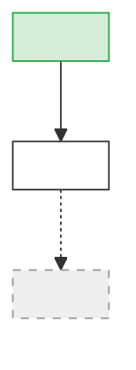

An **initiative** has arrived that is too big for one plan. One plan for all of it starts late, ends late, and learns from no build until the end. The **atlas** shortens that feedback loop. It charts the initiative as a graph of **nodes**. Each node gets its own plan and its own build, and each build sharpens the view of the nodes after it.

The atlas sits one level above `/wayfinder`. Wayfinder finds the way through one node. The atlas says which nodes exist, what each one gives to the others, and which ones can start now.

## Chart high, decide late

The atlas holds only what two or more nodes share. All other design waits for the session that plans the node, because that session knows more: the builds before it are complete. The pull to design a node is the signal that the chart is complete and that it is time to print the briefs.

## Node

A node is a **vertical** part of the initiative: when it is built, something new works from end to end, and a **done signal** proves it (a demo, a command, a metric). The first node is the thinnest one that works from end to end. A node that only prepares the ground (a migration, infrastructure) earns its place when a vertical node needs it.

Split a node only when each part has its own done signal and can be built and verified alone. Parts that must be designed together stay one node, at any size.

An **edge** from A to B means that B needs behaviour that A gives. The **frontier** is each `todo` node whose blockers are all `done`. Calculate it from the graph each time. Frontier nodes with no edge between them can run in parallel.

Each node has a **route**: the skill that plans it. Use `wayfinder` when the node has fog of its own, and `grill-with-docs` when its way is clear. Set the route for frontier nodes only.

## Cross-node decision

A decision is **cross-node** when two or more nodes depend on it: a shared contract, a shared data model, a hard constraint, a non-goal.

Settle a **contract** between nodes coarse: its owner, its direction, its rough shape. The first node that builds the contract settles the exact shape, because a contract written before its first use is usually wrong. A decision-only node, whose outcome is an ADR, is correct only when two nodes must start in parallel against one contract.

## Fog

The **fog** is the part of the initiative that you can see is coming but cannot yet state as nodes, because it depends on builds that are not done. Write each patch as loosely as the view allows and keep it whole: a patch can later become several nodes, or none. A patch shows in the graph as one dashed shape with the edges that are already visible.

## The atlas file

The atlas is `docs/initiatives/<slug>/README.md`. Subagent reports are in `research/` beside it.

The atlas is an **index**, not a store. A cross-node decision that is hard to reverse lives in an ADR, and the atlas holds its gist and the link. The graph is the only record of the edges.

Only an atlas session writes the atlas. A node session reads it.

````markdown
# <Initiative name>

## Goal

<what is true when the initiative is complete, in one or two lines>

## Non-goals

<work that is ruled out of this initiative>

## Cross-node decisions

- <one-line gist> ([ADR](link) when it is hard to reverse)

## Graph



## Nodes

### <Node name>

- **Outcome**: <what works from end to end when this node is built>
- **Done signal**: <the demo, command, or metric that proves it>
- **Needs**: <behaviour that it gets from earlier nodes>
- **Gives**: <behaviour that later nodes expect from it>
- **Route**: `wayfinder` | `grill-with-docs` | open
- **Status**: `todo` | `done`
- **Link**: <its wayfinder map, spec, or pull request, added when it is `done`>

## Fog

<each patch: the suspected area, and which build can make it clear>
````

## Brief

A **brief** is the paste-ready prompt that starts the session of one node. The node entry in the atlas stays the single source: the brief names the node and points to the atlas.

```
/<route>
Node "<node name>" of the initiative at <atlas path>.
Destination: <for wayfinder: a spec for this node | for grill-with-docs: a design for this node, ready for tickets>.

Notes for each session on this node (for wayfinder, copy them into the map's Notes):
- Read the atlas first: Goal, Cross-node decisions, the entry of this node, and each node that needs what this node gives.
- Plan this node only. The atlas is read-only in this session.
- If this node must change a cross-node decision, its Needs, or its Gives, stop and tell the user to run `/atlas <atlas path>`.
```

When there is no atlas, the brief carries the outcome, the done signal, and the facts from research in place of the atlas pointer.

## Invocation

Two modes. An argument that resolves to an atlas file starts **Re-plan**. All other arguments start **Chart**.

### Chart

The user invokes with a loose idea.

1. **Name the goal.** Call the Skill tool twice, for "grilling" and "domain-modeling". Done when the Goal and the Non-goals are settled with the user.
2. **Find the nodes.** Grill again, breadth-first. Facts come from subagents with a fresh context window: one that explores the repo, or one that calls the Skill tool with "research" for facts outside it. Your context stays with the conversation, so you hold only their conclusions. A subagent answers three questions: which nodes exist, what each node needs from the others, which unknown hides an edge. Research stops when the edge can be drawn or the item moves to fog; deeper research belongs to the session of the node. Each subagent saves its report in `research/`. Done when each part of the Goal belongs to a node or to a fog patch.
3. **Route by node count.**

   | Nodes found | Result |
   | --- | --- |
   | One, its way clear | A brief for `/grill-with-docs`. No atlas. |
   | One, with fog | A brief for `/wayfinder`. No atlas. |
   | Two or more | An atlas. |

   With one node, print the brief, delete the reports, and stop.
4. **Settle what the frontier needs.** Done when each frontier node has a full entry, each edge into a frontier node is drawn, and each cross-node decision that a frontier node needs is settled. A decision that only the fog needs stays open.
5. **Write the atlas.** The atlas and the briefs are documents for agents: call the Skill tool with "writing-for-agents" before you write them. Commit the atlas to the default branch and push it, so that each node session reads the same atlas.
6. **Print one brief for each frontier node**, then stop. The user starts each node session.

### Re-plan

The user invokes with an atlas, after a node is built or after a node session stopped on a cross-node conflict.

1. **Load the atlas and find what changed** since its last commit: the URL or the finding that the user gave, and the tracker issues and merged pull requests that name the atlas path. Done when each frontier node of the last commit has a known state: built, in work, or not started.
2. **Fold in each built node.** Set it to `done` and add its link. Compare what it gives now with the Needs of each later node and with the cross-node decisions. Correct the entries and the edges that the build changed.
3. **Clear the fog.** Turn each patch that the builds made sharp into nodes.
4. **Grill only on a change of shape.** A changed edge, a changed cross-node decision, or a patch that becomes nodes needs the user: call the Skill tool twice, for "grilling" and "domain-modeling", and use subagents for facts as in Chart. A re-plan with none of these runs without questions.
5. **Continue or close.** While a node is `todo` or a fog patch remains: commit, push, and print one brief for each frontier node. When all nodes are `done` and no fog remains: make sure that each cross-node decision that must stay is in an ADR or in the glossary, then delete `docs/initiatives/<slug>/` and commit.
